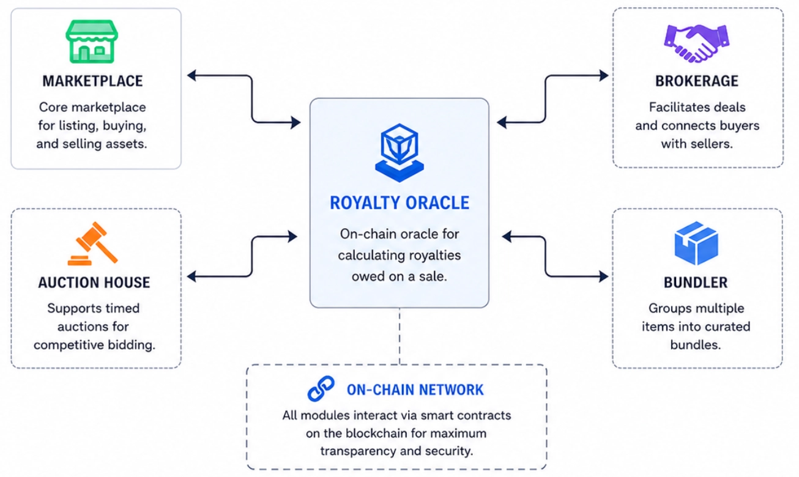
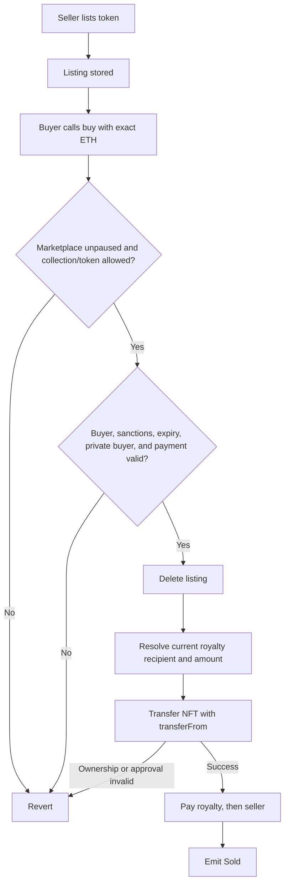
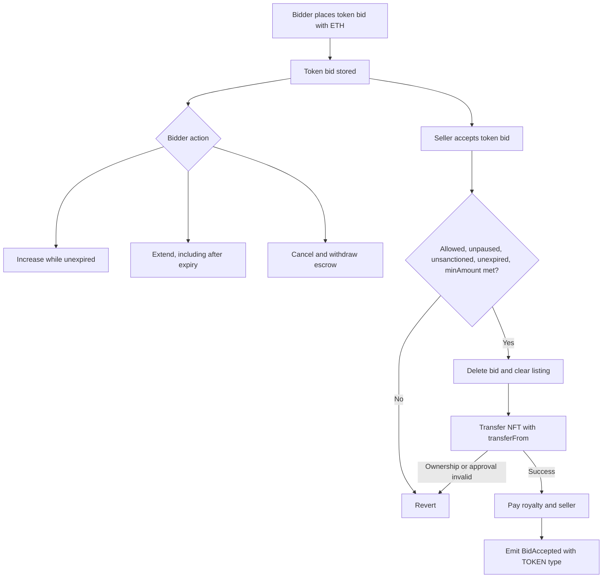
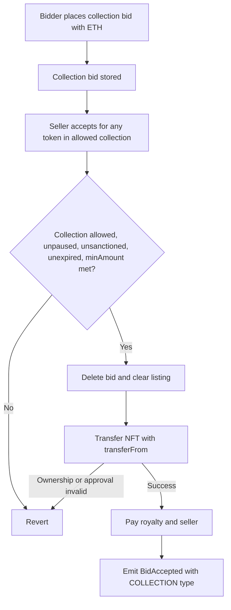
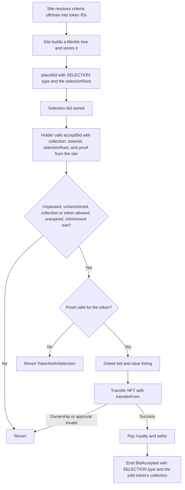

# Luci Market

A bespoke ETH marketplace for trading ERC-721 tokens from Sam Spratt collections. The system supports fixed-price listings, token bids, collection bids, selection bids on any set of tokens across collections, escrowed ETH offers, sanctions checks, token-level allowlisting for shared contracts, and enforced on-chain royalties through an external royalty model.



## Contracts

- `LuciMarket` in `src/LuciMarket.sol` handles listings, bid escrow, settlement, collection/token allowlists, selection proof checks, pausing, and sanctions checks.
- `LuciRoyaltyModel` in `src/LuciRoyaltyModel.sol` calculates royalties from configured mint prices and holds the royalty recipient.
- `ISanctionsList` in `src/interfaces/ISanctionsList.sol` is the Chainalysis-compatible sanctions interface used by the marketplace.
- `IAggregatorV3` in `src/interfaces/IAggregatorV3.sol` is the minimal Chainlink aggregator interface used by the royalty model to read `<currency>/USD` price feeds.

Both main contracts use `Ownable2Step`. The marketplace owner and royalty model owner may be the same address, but they are separate ownership domains.

## Deployment

Recorded deployments live in `deployments.json`. Each version stores `constructor_args`, `salt`, and `deployed_contract`. Copy `sample.env` to `.env` and set the RPC URLs, `ETHERSCAN_KEY`, `SENDER`, `CONSTRUCTOR_ARGS`, and `SALT`.

`script/Deploy.s.sol` deploys one contract at a time through the canonical CreateX factory (`0xba5Ed099633D3B313e4D5F7bdc1305d3c28ba5Ed`) using CREATE3. The address comes from the sender and salt, so Sepolia and mainnet can use different constructor arguments and still land on the same address. Deploy `LuciRoyaltyModel` first. Its logged address goes into the `LuciMarket` constructor, including that chain's sanctions list.

```sh
cast abi-encode "constructor(address,address)" <owner> <royaltyRecipient>
make deploy_LuciRoyaltyModel_testnet

cast abi-encode "constructor(address,address,address)" <owner> <royaltyModel> <sanctionsList>
make deploy_LuciMarket_testnet
```

`SALT` is 32 bytes. The first 20 bytes are `SENDER`, which stops anyone else from taking the salt. Byte 21 is `0x00` when Sepolia and mainnet should share an address, or `0x01` when the chain id should be part of the salt. Use a different salt for each contract.

Use the `_mainnet` targets for Ethereum mainnet. The script takes an RPC alias from `foundry.toml` and the chain id that RPC must report. To add a chain, add its `[rpc_endpoints]` and `[etherscan]` entries and copy a Makefile target with the new alias, chain id, and `--chain` value. The script signs with a Ledger (`--ledger`) from `SENDER`. After a broadcast, copy the address, constructor arguments, and salt into `deployments.json`.

Chain-specific setup is separate from deployment. From the owner, with `cast calldata` or `cast send`:

1. `configureCurrency(address,address,uint8,uint8,uint32)` on `LuciRoyaltyModel` for native ETH (`address(0)`, 18 currency decimals, the ETH/USD feed, its decimals, and `maxAge`).
2. `addCollection(address)` on `LuciMarket`.
3. `configureCollection(address,uint192)` on `LuciRoyaltyModel` with the mint price in USD, 8 decimals.

## Listings

Token owners can list NFTs for a fixed ETH price. Listings are time-gated with a maximum duration of 180 days and do not escrow the NFT. The token remains in the seller's wallet until purchased. Listing requires the marketplace to be approved for the token so incorrect approval or UI flows fail immediately instead of publishing an already unfulfillable listing. Listings do not store a royalty amount; royalties are resolved at settlement, so `list` makes no call to the royalty model. Calling `list` again for the same token updates or replaces the stored listing, including stale listings left by a previous owner.

Listings can be public or private. A public listing sets `buyer` to `address(0)` and can be purchased by anyone. A private listing sets `buyer` to a specific address, and only that address can call `buy`.

Listings can be extended in batch while the marketplace is unpaused and the collection or token remains allowed. Extension can revive expired listings as long as the stored seller calls it, still owns the token, still has the marketplace approved, and the new expiration is valid. Listings can be delisted at any time, including while the marketplace is paused, after the collection/token has been removed from the allowlist, or while the seller is sanctioned. Delisting does not transfer or release assets, so it does not perform a sanctions check.

If a listed token is transferred outside the marketplace, the listing becomes stale. Approval can also be revoked after listing. At settlement, the ERC-721 `transferFrom` call enforces that the stored seller currently owns the token and that the marketplace is currently approved. A stale or approval-blocked listing can become executable again if the original seller reacquires or re-approves the token before expiry, so frontends and indexers should filter stale listings. A stale listing cannot be extended while the seller does not own the token or has not approved the marketplace, so it lapses at its original expiry at the latest.

## Offers

There are three bid types. Each bid escrows ETH when placed and stores an amount plus an expiration timestamp. `expiresAt == 0` means no expiry; otherwise a bid is fillable through the exact expiration timestamp and expires once `block.timestamp > expiresAt`.

- **Token bid**: a bid on a specific token.
- **Collection bid**: a standing bid for any token in an allowed collection.
- **Selection bid**: a standing bid for any token in a set of tokens committed to by a Merkle root, which can span collections. See [Selection Bids](#selection-bids).

A bidder can hold one stored bid per token, per collection, and per selection. Expired bids still occupy their key until the bidder cancels them or extends them. Bids can be increased while unexpired, extended even after expiry, or canceled while expired. Increasing and extending require the marketplace to be unpaused. For token and collection bids they also require the relevant collection or token to be allowed; selection bids check eligibility per token at acceptance instead.

Bid placement, increases, and acceptance use a unified `BidSelector` API. The selector's `bidType` determines whether `tokenId` identifies a token bid, `collection` identifies a collection bid, or `selectionRoot` identifies a selection bid. When accepting any bid, `collection` and `tokenId` identify the NFT being sold. `acceptBid` also takes a Merkle `proof`, which only selection bids use; token and collection bids pass an empty array. Each placement or increase funds exactly one bid; only extension and cancellation support batching. Bid lifecycle logs use the generic `BidPlaced`, `BidIncreased`, `BidExtended`, `BidCanceled`, and `BidAccepted` events, with `bidType`, `collection`, and `bidder` indexed. Fields a bid type does not use are emitted as zero. Selection bid events emit `address(0)` as the `collection`, except `BidAccepted`, which emits the sold token's collection.

Bid acceptance includes a `minAmount` parameter to protect the seller from accepting less than expected if the bid changes before the seller's transaction executes. Accepted bids are deleted, and accepting any bid for a token clears that token's existing listing to avoid leaving a stale listing behind.

Bid cancellation is available while the marketplace is paused or unpaused and does not require the collection to remain allowed. Cancellation is blocked while the bidder is sanctioned; once the bidder is no longer sanctioned, the bidder can cancel and withdraw escrowed ETH.

## Order Flows

The diagrams below are documentation-only summaries of the contract flow. The Solidity source remains the authority.

### Listing Purchase



### Token Bid



### Collection Bid



### Selection Bid



## Collection And Token Allowlisting

The marketplace supports two allowlist modes:

- **Allowed collections**: full collection support. Tokens in an allowed collection can be listed, bought, bid on with token bids and collection bids, and sold into selection bids.
- **Allowed tokens**: token-level support for shared contracts. An individually allowed token can be listed, bought, bid on with token bids, and sold into selection bids, but it is not eligible for collection bids.

The token allowlist only adds tokens from shared contracts whose collection is not allowed. It is not a blocklist: every token in an allowed collection is tradable regardless of `allowedTokens`, so `removeToken` only affects a token whose collection is not allowed.

Removing a collection, or removing an individually allowed token from a collection that is not allowed, blocks new orders, extensions, and fulfillment for that collection or token, but it does not delete existing listings or escrowed bids. Selection bids are the exception for new orders and extensions: the contract does not know a selection's contents, so removal blocks the token from fulfillment, but selection bids that include it can still be placed, increased, and extended (see [Eligibility](#eligibility)). Users can still delist without a sanctions check. Bid cancellation remains subject to sanctions checks because it returns escrowed ETH. If a collection or token is later allowed again, unexpired orders can become executable again unless users have removed them.

## Royalty Model

Royalties are calculated by `LuciRoyaltyModel` from a configured mint price. **Mint prices are denominated in USD with 8 decimals.** The marketplace calls:

```solidity
calculateRoyalty(collection, tokenId, salePrice, currency)
```

The royalty percentage is determined in USD terms — the sale price is converted to USD through a registered price feed — and that percentage is then applied to the sale price in its original currency. The marketplace settles in ETH only and always passes `NATIVE_CURRENCY` (`address(0)`).

The royalty model returns the royalty recipient and the royalty amount. Before paying a positive royalty, the marketplace checks that the recipient is not sanctioned, then pays royalties before paying seller proceeds. **Both the recipient and the amount are resolved live at settlement** for listings and bids alike, so a listing settles at the royalty implied by the ETH/USD rate at the time of purchase rather than a rate snapshotted at listing time.

The marketplace enforces its own hard ceiling on every settlement:

```solidity
if (royaltyAmount > Math.mulDiv(salePrice, MAX_ROYALTY_BPS, BASIS)) revert InvalidRoyaltyAmount();
```

`LuciMarket.MAX_ROYALTY_BPS` is `1_000` (10%). This bound holds regardless of which royalty model the owner has configured, so collectors have an on-chain assurance that survives a `setRoyaltyModel` swap. Settlement also rejects a zero royalty recipient when the royalty amount is positive, so a swapped model cannot burn the cut.

### Configuration

The royalty model owner can:

- Set the royalty recipient.
- Configure a collection mint price, in USD with 8 decimals.
- Override the mint price for a specific token, in USD with 8 decimals.
- Clear a token mint-price override so the collection mint applies again (`clearTokenOverride`).
- Register a sale currency with its `<currency>/USD` price feed, currency decimals, and staleness window (`configureCurrency`).
- Remove a sale currency (`removeCurrency`).

Token overrides take precedence over collection configuration when the token override is enabled. Clearing an override returns that token to the collection mint. A zero address royalty recipient is rejected in the royalty model constructor and setter, and by the marketplace at settlement when the royalty amount is positive. `configureCurrency` rejects a zero oracle, a zero `maxAge`, and currency or feed decimals above 18. The feed's decimals are owner-declared at configuration time rather than probed. Conversion re-reads `decimals()` live and falls back to the maximum royalty if they differ from the stored value, so a wrong declaration or a scale change without a matching `answer` rescaling cannot under-charge.

A freshly deployed royalty model has no currencies registered, so every sale falls back to the maximum royalty until `configureCurrency` is called for the native currency (`address(0)`, 18 decimals) with the ETH/USD feed. Registering currencies and configuring collection mint prices are both required deployment steps.

### Price Conversion

```solidity
usd = Math.mulDiv(amount, answer * 10 ** USD_DECIMALS, 10 ** currencyDecimals * 10 ** oracleDecimals);
```

Conversion fails — and the model falls back to the **maximum royalty** — when the currency is not registered, the feed reverts, `answer <= 0`, `updatedAt` is zero or in the future, the answer is older than the currency's configured `maxAge`, `answer * 10 ** USD_DECIMALS` would overflow, the converted USD value would overflow, or live `decimals()` differs from the value stored at `configureCurrency`. A revert from live `decimals()` after a successful round is not caught and reverts settlement, so an oracle that does not fully follow the aggregator interface carries a slight chance of blocking trading until the currency is reconfigured. Falling back rather than reverting keeps trading available during a feed outage while never under-charging royalties. Freshness is `updatedAt` versus `maxAge`; Chainlink's `answeredInRound` is deprecated and is not checked.

`MAX_CURRENCY_DECIMALS` is `18`, matching real currencies and Chainlink feeds (8 or 18). The bound is enforced at configuration time for the currency and the feed. An `answer` large enough that `answer * 10 ** USD_DECIMALS` would overflow, or a converted USD value large enough to overflow `uint256`, is treated as a failed conversion rather than reverting settlement. Neither overflow is reachable on a realistic ETH/USD tick.

### Choosing `maxAge`

`maxAge` is per currency and should be set from the specific feed's heartbeat, which varies by feed and by chain. Chainlink feeds publish on a heartbeat **or** a deviation threshold, whichever comes first, so an answer can only be old if the price has stayed inside the deviation band for that entire window. The error absorbed from an old answer is therefore bounded by the deviation threshold rather than by how far the market moved.

The fallback is the maximum royalty, so the failure modes are asymmetric. A `maxAge` set too tight does not block trading, but it silently charges a full 10% during a normal quiet stretch between updates. A `maxAge` set loosely only admits an answer whose error is bounded by the deviation threshold. False positives are the more expensive mistake, which argues for a generous window.

For Ethereum mainnet ETH/USD (1 hour heartbeat, 0.5% deviation), **4 hours** is the intended deployment value: long enough that tripping it means the feed is genuinely broken, while the staleness it admits shifts the royalty by a few basis points at most. `maxAge` is a `uint32` and owner-settable through `configureCurrency`, so it can be retuned without a redeploy. Test fixtures use a shorter window so that tests can warp past it.

### Formula

Constants:

```solidity
BASIS = 10_000
MAX_ROYALTY_BPS = 1_000 // 10%
```

The effective mint price is:

1. `tokenOverrides[collection][tokenId].mintPriceUsd` when the token override is enabled.
2. Otherwise `collections[collection].mintPriceUsd`.
3. Otherwise `0`.

Let `saleUsd` be the sale price converted to USD. Royalty behavior:

| Scenario | Royalty |
| --- | --- |
| `saleUsd <= mintPriceUsd` | 0 |
| `saleUsd >= mintPriceUsd * 2` | 10% of sale price |
| `mintPriceUsd < saleUsd < mintPriceUsd * 2` | Sliding scale from 0% to 10% |
| Unconfigured collection/token and positive sale price | 10% of sale price |
| Unregistered currency, or stale/invalid/reverting feed | 10% of sale price |

For the sliding-scale range:

```solidity
royalty = Math.mulDiv(salePrice, (saleUsd - mintPriceUsd) * MAX_ROYALTY_BPS, mintPriceUsd * BASIS);
```

The percentage is derived in USD and then applied to the sale price in its own currency. Units cancel (ETH × USD / USD), so this is a single `mulDiv` rather than truncating to integer basis points first. The result still rounds down, so the royalty never exceeds 10% of the sale price.

Unconfigured collections intentionally default to `mintPriceUsd == 0`, which charges full royalties for any positive sale price. A configured collection or enabled token override with a zero mint price has the same positive-sale behavior. The marketplace owner controls which collections and tokens can trade, so royalty readiness is an operational allowlist decision.

## Selection Bids

A selection bid is an escrowed ETH offer on an explicit set of tokens. Any holder of a token in the set can accept it, and the set can span multiple collections. The set is committed to by a Merkle root: the contract stores only the root, inside the bid. The site resolves traits, or any other criteria, offchain, builds the tree, and keeps it so it can hand sellers their proofs.

> **The site MUST NOT offer trait-based selections for collections whose metadata can still change.** A selection is a frozen snapshot of token IDs. If a token's traits change after the bid is placed, the selection still reflects the old traits: a "Gold Background" bid could be filled with a token that no longer has a gold background, and a token that gains one is not included. Only build trait selections for collections with frozen metadata.

### Merkle Tree Format

Trees use the [OpenZeppelin standard Merkle tree](https://github.com/OpenZeppelin/merkle-tree) format, so `StandardMerkleTree.of(values, ["address", "uint256"])` from `@openzeppelin/merkle-tree` produces compatible roots and proofs:

- Each leaf is `keccak256(bytes.concat(keccak256(abi.encode(collection, tokenId))))`. The double hash keeps a leaf from ever being confused with an internal node.
- Pairs are hashed in sorted order, and proofs are verified with OpenZeppelin's `MerkleProof`.
- `selectionRoot` is the selection's Merkle root. A zero root is rejected with `InvalidSelection`.

The same token ID in two collections is two different leaves. Any `uint256` token ID is supported. `test_openZeppelinStandardMerkleTreeVector` pins a root and proofs generated by `@openzeppelin/merkle-tree` 1.0.8.

### Lifecycle

- `placeBid` with `bidType = SELECTION` and the `selectionRoot` places a bid. There is no creation step, and placement costs the same whatever the selection's size.
- `increaseBid`, `extendBids`, and `cancelBids` take the `selectionRoot` like any other bid type.
- `acceptBid(bidSelector, bidder, minAmount, proof)` sells a token into a selection bid, with `bidSelector.collection` and `bidSelector.tokenId` naming the token. It reverts with `TokenNotInSelection` if the proof does not show the token is in the selection. A single-token selection's root is its leaf, so it takes an empty proof.
- `isInSelection(selectionRoot, collection, tokenId, proof)` verifies a proof. It does not check the allowlist.

Many bidders can bid on the same root. Filling or canceling a bid deletes only that bid.

### Data Availability

The contract never sees a selection's contents. If the tree behind a root is lost, nobody can produce proofs and the bid cannot be filled. The escrowed ETH is never at risk: the bidder can cancel at any time. The site must store every tree it builds, keyed by root, and serve proofs to sellers.

Bidders sign a bare root, so they rely on the site to build the tree they intended. The site should show the selection's contents, and the criteria that produced them, before the bidder signs.

### Eligibility

Selection bids use the same per-token rule as listings and token bids: a token is eligible if its collection is allowed or the token itself is in `allowedTokens`.

- **At acceptance**, the token being sold is checked. A token that is not eligible cannot fill a bid, while the selection's other members stay fillable. If the token is allowed again, it can fill again.
- **Placing, increasing, and extending** do not check the allowlist, because the contract does not know which tokens a selection contains. A selection can include tokens that are not eligible, and bids on it can still be placed. Those tokens simply cannot fill. The site should only build selections from eligible tokens and flag selections whose members have lost their allowed status.

### Gas

Measured in `test_gasSelectionBidsByProofDepth` (run with `-vv` to print the figures). Each figure is the cost of a standalone transaction: the 21,000 base, calldata, and execution against cold storage, with no sanctions list configured.

| Operation | Gas |
| --- | --- |
| Place a token bid, for reference | ~78k |
| Place a selection bid, any size | ~76k |
| Accept a token bid, for reference | ~141k |
| Accept a selection bid, proof depth 0 (1 token) | ~143k |
| Accept, depth 7 (up to 128 tokens) | ~152k |
| Accept, depth 10 (up to 1,024 tokens) | ~155k |
| Accept, depth 14 (up to 16,384 tokens) | ~160k |
| Accept, depth 17 (up to 131,072 tokens) | ~164k |
| Accept, depth 20 (up to ~1M tokens) | ~168k |

A tree of `n` tokens has a proof depth of about `log2(n)`, and each level adds about 1.3k gas to acceptance. Placing a selection bid is slightly cheaper than a token bid because it reads no allowlist entry. Selections have no practical size limit.

## Sanctions Checks

The marketplace can be configured with a Chainalysis-compatible sanctions list. If `sanctionsList` is `address(0)`, sanctions checks are disabled.

When a sanctions list is configured:

- Sanctioned users cannot list, extend listings, buy, place bids, increase bids, extend bids, cancel bids, or accept bids.
- Sanctioned sellers can delist because deleting a listing does not transfer or release assets.
- Buyers are checked in `buy`.
- Listing sellers are checked in `buy`.
- Sellers and bidders are checked when bids are accepted.
- Royalty recipients are checked at settlement when the royalty amount is greater than zero.
- Bid escrow remains in the contract while a bidder is sanctioned. The bidder can cancel and withdraw only after removal from the sanctions list.

The marketplace owner can update the sanctions list address.

## Pause Behavior

When paused:

- New listings, listing extensions, purchases, bid placements, bid increases, bid extensions, and bid acceptances are blocked.
- Delisting remains available without a sanctions check.
- Bid cancellation remains available, subject to sanctions checks.

Pausing does not delete orders or refund escrow automatically.

## Access Control

The marketplace owner manages:

- Collection allowlist.
- Token allowlist for shared contracts.
- Pause state.
- Royalty model address.
- Sanctions list address.

The royalty model owner manages:

- Royalty recipient.
- Collection mint price configuration (USD).
- Token mint price overrides (USD), including clearing an override.
- Sale currency registry and the price feeds backing it.

The owner does not manage selections. The marketplace never sees trait data or a selection's contents; the mapping from traits to tokens, and storage of the trees, is the site's responsibility. The allowlist bounds which tokens can fill a selection bid.

## Known Limitations

- **Non-escrowed listings**: listed NFTs remain in seller wallets.
- **Stale listings**: listings are not automatically invalidated when NFTs transfer outside the marketplace.
- **ETH only**: ERC-20 payments are not supported by the marketplace. The royalty model is currency-aware ahead of this and can already price non-native currencies with their own decimals and feeds.
- **Oracle dependence**: USD-denominated royalties require a live `<currency>/USD` feed. A feed outage degrades to the maximum royalty rather than blocking trades.
- **No partial fills**: each accepted bid is consumed in full.
- **One stored bid per key**: bidders can hold one collection bid per collection, one token bid per token, and one selection bid per selection. Expired bids still occupy storage until canceled or extended.
- **Offchain selection data**: a selection bid can only be filled with a proof built from the tree behind its root. If the tree is lost, the bid cannot be filled until the bidder cancels it.
- **Immutable selections**: a root commits to a fixed set of tokens. A different set of tokens is a different selection with its own ID.
- **Indexed reads required**: active offers are spread across bidder-keyed mappings and are not enumerable on-chain.

## Known Tradeoffs

- **Full royalty fallback**: unconfigured royalty entries default to full royalties for positive sale prices instead of reverting. The same fallback applies when the sale price cannot be converted to USD (unregistered currency, or a stale, non-positive, or reverting feed answer), trading availability being preferred over an exact percentage.
- **Live royalty resolution**: listings do not lock in a royalty amount. Seller proceeds on an open listing move with the ETH/USD rate, which is the cost of keeping the mint price pinned in USD.
- **User-managed stale orders**: users, frontends, and indexers are expected to manage stale listings and stale bids. Fulfillment paths re-check ownership, approval, allowlist status, selection membership, expiration, sanctions status, and payment amount.
- **Re-approved orders can reactivate**: removing a collection or token blocks fulfillment while removed, but existing unexpired orders can become executable again if allowlisted later.
- **Selection allowlist checks at fill only**: placing, increasing, and extending a selection bid do not check the allowlist, because the contract does not know the selection's contents. A selection can include tokens that are not eligible; those tokens cannot fill until allowed.
- **Selections are snapshots**: a selection records token IDs, not the criteria that produced them. Trait-based selections are only correct for collections with frozen metadata.
- **Fixed-gas ETH transfers**: ETH payouts use `call` with `100_000` gas. This supports normal EOAs and many smart wallets while bounding recipient execution, but recipients requiring more gas can cause their own payout path to revert.
- **Current royalty recipient availability**: existing listings pay the royalty amount resolved at settlement to the recipient returned by the current royalty model. If that recipient cannot accept ETH within the fixed gas cap, settlement reverts.
- **Allowed collection trust**: settlement uses `transferFrom` and assumes allowed ERC-721 collections behave correctly.

## Security Considerations

- **Reentrancy**: external state-changing functions use `ReentrancyGuardTransient`. State changes happen before external calls.
- **Contract buyers**: NFT transfers use `transferFrom`, so settlement does not call `onERC721Received`. Contract buyers are responsible for ensuring they can manage received NFTs.
- **ETH payouts**: failed ETH sends revert settlement or cancellation. Contract sellers, bidders, or royalty recipients should be able to receive ETH within the gas cap.
- **Sanctioned escrow**: sanctioned bidders cannot withdraw bid escrow until no longer sanctioned.
- **Owner trust**: owners can pause trading, change allowlists, change the royalty model, change sanctions enforcement, and configure royalties, currencies, and price feeds.
- **Selection proofs**: membership is verified with OpenZeppelin's `MerkleProof` against double-hashed leaves, so internal nodes cannot be passed off as leaves. The contract cannot tell what a root contains; bidders trust the site to build the tree they intended, and an unrecoverable tree only makes a bid unfillable, never unrefundable.
- **Marketplace royalty ceiling**: `LuciMarket` rejects any settlement where the royalty exceeds `MAX_ROYALTY_BPS` (10%) of the sale price, or where a positive royalty would be paid to the zero address. Both checks run in `_settleSale`, covering `buy` and `acceptBid`, and apply to any royalty model the owner configures.
- **Oracle trust**: the royalty model calls an owner-configured price feed during settlement. A degraded feed, or a live `decimals()` change relative to configure time, falls back to the maximum royalty rather than reverting, and the royalty model owner can point a currency at any contract. The marketplace royalty ceiling bounds the impact.

### Audit

`audit/Luci Market Contract Review.pdf` is an external review of the core trading, escrow, bid, allowlist, and sanctions logic. `audit/POST_AUDIT_CHANGES.md` records exactly which commit was reviewed and every `src/` change made since, including the USD royalty work and the replacement of trait bids with selection bids, neither of which has been externally re-reviewed.

## Indexing Considerations

The indexing layer should enrich on-chain events into a queryable model. Key responsibilities:

- Track listing state and current token ownership.
- Hide listings where the stored seller no longer owns the token.
- Optionally mark stale listings as active again if the original seller reacquires the token before expiry.
- Aggregate token, collection, and selection bids for token and collection pages.
- Store every Merkle tree the site builds, keyed by root, and serve proofs to sellers. A `BidPlaced` event with an unknown root is a selection the site cannot fill.
- Index each tree's members, so a token page can list every selection bid that token can fill, and notify holders when one is placed.
- Record which criteria produced each selection root for display.
- Track sanctions and allowlist changes that affect order executability.
- Read royalty amounts from `Sold` and `BidAccepted`. `Listed` no longer carries a royalty amount, because royalties are resolved at settlement rather than at listing time.

On-chain bid data is keyed by bidder address, so event indexing is required for practical offer discovery.
